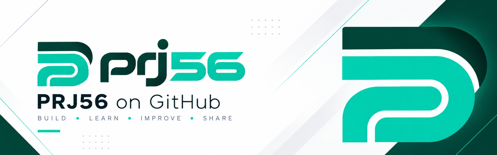

  <strong>Software Development &amp; Web Engineering</strong> 
  Building practical software and modern web experiences.

---

## About PRJ56

**PRJ56** is an independent development brand focused on software engineering and web development. The goal is simple: create useful, well-structured projects while continuously learning and improving.

## What We Do

- **Software development** — Building applications, tools, and practical solutions.
- **Web development** — Creating responsive websites and interactive web experiences.
- **Technical exploration** — Experimenting with new technologies and better ways to build.

## Technologies

| Area | Technologies |
| --- | --- |
| Programming | Python, JavaScript, C#, Lua |
| Web | HTML, CSS, JavaScript |
| Currently learning | TypeScript |

## Our Approach

**Build. Learn. Improve. Share.**

We value clear code, thoughtful design, and steady iteration. Each project is an opportunity to solve a problem, develop new skills, and make something better.

## Projects & Repositories

Explore our public work, experiments, and upcoming projects on GitHub.

**[Explore PRJ56 repositories →](https://github.com/prj56?tab=repositories)**

---

  PRJ56 · Software Development &amp; Web Engineering

